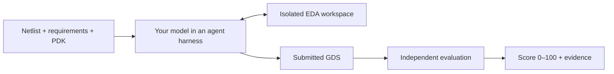

<h1 align="center">ICLayout-Bench</h1>

<p align="center">
  <strong>A benchmark framework for AI-driven integrated-circuit layout.</strong><br>
  <sub>From netlists to GDS, with isolated EDA tools and independent evaluation.</sub>
</p>

<p align="center">
  <a href="README_CN.md">简体中文</a> ·
  <a href="#quick-start">Quick Start</a> ·
  <a href="https://huggingface.co/datasets/lizhangmai/ICLayout-Bench">Dataset</a> ·
  <a href="#documentation">Documentation</a> ·
  <a href="https://github.com/lizhangmai/ICLayout-Bench/issues">Issues</a>
</p>

<p align="center">
  <a href="https://github.com/lizhangmai/ICLayout-Bench/actions/workflows/checks.yml"></a>
  <a href="docs/running.md#experiment-environment"></a>
  <a href="LICENSE"></a>
</p>

## Why ICLayout-Bench?

ICLayout-Bench measures how well an LLM agent turns a transistor-level circuit,
its operating conditions and a process design kit (PDK) into a correct,
high-quality layout. You evaluate a model through an agent CLI (a *harness*):
Bench gives the agent each task and an isolated EDA workspace, freezes the GDS it
submits and scores that layout independently.



The public [ICLayout-Bench Dataset](https://huggingface.co/datasets/lizhangmai/ICLayout-Bench)
provides 92 tasks on four open PDKs (FreePDK45, GF180MCU, IHP SG13G2 and
SKY130A), from logic cells and SRAM to regulators, data converters and RF
amplifiers. Its 21-task **core** selection is the standard benchmark.

| Capability | What it provides |
| --- | --- |
| **End-to-end layout tasks** | Declared netlists, operating conditions, physical constraints and PDK resources, with GDS as the submission. |
| **Independent evaluation** | Artifact checks, DRC, LVS, parasitic extraction and post-layout measurements on frozen candidate bytes. |
| **Native agent harnesses** | Codex, Claude Code, DSH, Kimi Code and ZCode, plus custom controllers through HTTP/MCP. |
| **Repeatable experiments** | Explicit model/effort conditions, independent repetitions, saved evidence and interrupted-session recovery. |
| **Usage and cost analysis** | Native token counts, timing and cost coverage alongside the independent score. |

## Choose your path

| You want to | Start here |
| --- | --- |
| Evaluate a model or agent on your own machine | [Quick Start](#quick-start) |
| Benchmark your own agent program, or add tools such as MCP servers | [Custom controllers](docs/running.md#custom-controllers) and [tool schemes](docs/running.md#participant-tool-schemes) |
| Score a GDS you already have, without a model | [Standalone evaluation](docs/running.md#standalone-evaluation) |

## Prerequisites

You need:

- **Linux x86-64** with **Docker** usable by your account, and **Bubblewrap**
  (`bwrap`, usually the `bubblewrap` package), which sandboxes the agent CLI.
- **Python 3.12+** and **Git**.
- **One supported agent CLI**, installed and signed in, that can reach the model
  you want to evaluate; see [step 2](#2-connect-your-model).
- **Access to Hugging Face** to download the public Dataset on first use, or a
  local Dataset directory.

<a id="install-and-run"></a>

## Quick Start

### 1. Install Bench and the EDA image

In a fresh Python 3.12+ virtual environment:

```bash
python -m pip install iclayout-bench
docker pull docker.io/lizhangmai/iclayout-bench-tools:latest
```

The package contains the framework only; tasks come from the Dataset and EDA
tools from the image. Check the host before the first run:

```bash
python -m benchmarking.eda doctor                                 # Linux, Python, Git, Docker
bwrap --unshare-all --share-net --ro-bind / / true && echo "bwrap OK"
```

For wheel or source installs, see [installation options](docs/running.md#experiment-environment);
to use another image, see [images](docs/tools.md#prebuilt-images-and-local-builds).

### 2. Connect your model

Bench does not call model APIs itself. It launches an agent CLI that talks to
your model and records the model ID and effort with every result. Choose the
harness that can reach your model, then sign in with that CLI:

| Your model is reached through | `harness` | `model` value | Setup |
| --- | --- | --- | --- |
| OpenAI (ChatGPT sign-in or API key) | `codex` | A model ID accepted by Codex | `codex login`; see [Codex](docs/running.md#codex) |
| Anthropic (Claude sign-in or API key) | `claude-code` | A model ID accepted by Claude Code | Sign in to Claude Code; see [Claude Code](docs/running.md#claude-code-and-dsh) |
| Kimi Code account | `kimi-code` | A model alias in your Kimi configuration | `kimi login`; see [Kimi Code](docs/running.md#kimi-code) |
| BigModel or Z.AI coding plan | `zcode` | `account:<plan>/<model>` | `zcode login` in a dedicated profile; see [ZCode](docs/running.md#zcode) |
| Any OpenAI- or Anthropic-compatible API | `zcode` | `<provider>/<model>` | Endpoint and key variable in a profile `config.json`; see [ZCode](docs/running.md#zcode) |
| DSH | `dsh` | A model ID accepted by DSH | `settings.yaml` in its home; see [DSH](docs/running.md#claude-code-and-dsh) |
| Your own agent program | `command` | A label recorded with results | `[scheme.launch]`; see [custom controllers](docs/running.md#custom-controllers) |

By default a native harness uses your CLI's normal sign-in. To keep benchmark
credentials separate, sign in inside a dedicated profile directory and point
`harness_home` at it ([details](docs/running.md#native-harness-configuration)).
Each run is sandboxed: the agent sees the task and Bench's tools, not your
personal skills, rules, memories, plugins or MCP servers, and the configured
model and effort override the CLI's own settings.

### 3. Write `experiment.toml`

```toml
harness = "codex"            # harness from step 2
model = "your-model-id"      # exact model ID for that harness
effort = "medium"            # reasoning effort the model supports
concurrency = 1              # tasks solved at the same time
repetitions = 1              # independent solves per task
# harness_home = "profiles/codex"   # optional dedicated sign-in profile

[dataset]
source = "lizhangmai/ICLayout-Bench"  # Dataset repository ID or local directory
name = "core"                         # "core" benchmark or "all" tasks
split = "test"
```

Paths in this file resolve from its own directory. The full field list is in the
[configuration reference](docs/running.md#configuration-reference).

### 4. Check the setup, then solve one task

```bash
# Resolve configuration and task bindings; no model or Docker calls.
python -m benchmarking.run --config experiment.toml --case NAND2_X1 --dry-run

# Solve and evaluate one small task. This makes real model calls.
python -m benchmarking.run --config experiment.toml --case NAND2_X1
```

Bench downloads the Dataset on first use. `NAND2_X1`, a two-input logic gate,
is a quick end-to-end check. The agent works until it submits or the task's
solve budget runs out; each task declares its own budget, from one to a few
hours. Dry-run does not test sign-in, quota or Docker; the first real run does.

### 5. Read the result

Results are grouped under `results/<config-file-name>/`:

```bash
python -m benchmarking.run --status --output results/experiment
```

The status lists every task run with its `state`, independent `outcome`
(`pass` or `fail`) and `score` (0–100). Each run directory,
`results/experiment/<task-id>/<timestamp>/`, keeps the evidence:

| File | Contents |
| --- | --- |
| `result.json` | Score and metrics, verdict, condition, token usage and known cost |
| `final.gds`, `layout.png` | The scored layout and its preview |
| `evaluation/` | Evaluation plan, measurements and DRC/LVS/extraction/simulation logs |
| `agent.jsonl`, `native/` | Agent launches and native conversation logs |

See [reading a run](docs/running.md#read-a-run) for every field.

### 6. Run the core benchmark

Omit `--case` to run every task in the selection. For a long batch, choose an
output directory and run it in the background:

```bash
python -m benchmarking.run --config experiment.toml --output results/my-model --detach
python -m benchmarking.run --status --output results/my-model   # progress and scores
python -m benchmarking.run --stop --output results/my-model     # stop, keeping evidence
python -m benchmarking.run --config experiment.toml --output results/my-model --resume --detach
```

The last command continues an interrupted batch: finished tasks are skipped and
unfinished sessions keep their original deadlines. With `concurrency = 1` the
core tasks run one after another, each for up to its solve budget, so a full
pass can take more than a day. Raise `concurrency` within your machine's
resources and your provider's rate limits. See
[failure recovery](docs/running.md#failure-recovery) for the other options.

## Next steps

- **Compare models or efforts:** use `efforts = ["medium", "high"]`, several
  `--config` files or a matrix; set `repetitions` for independent repeats.
  See [multiple conditions](docs/running.md#multiple-conditions-and-repetitions).
- **Track usage and cost:** add a `[pricing]` table, then export per-run tokens,
  cost and duration with
  `python -m benchmarking.analyze results/my-model/*/*/result.json --output results/my-model-analysis`.
  See [usage and cost](docs/running.md#model-usage-and-cost).
- **Add participant tools:** declare MCP servers, instructions or a solver image
  in a `[scheme]`. See [participant tool schemes](docs/running.md#participant-tool-schemes).

## How scoring works

The Agent performs device implementation, placement, routing and iteration in
its EDA workspace, and may run process checks before submitting. The evaluator
then checks the accepted layout snapshot in a separate trusted environment:
artifact checks, DRC, LVS, parasitic extraction and post-layout measurements.
Rejected layouts score 0, as do runs that end with an exhausted budget or an
agent error; infrastructure errors leave the score unknown rather than zero.
Valid layouts score up to **100**, measuring electrical and area quality against
each task's declared targets. A feasible layout can still have room to improve.
See [scoring](docs/tasks.md#task-scoring).

<a id="resources"></a>

## Documentation

| Need | Guide |
| --- | --- |
| Configure harnesses, run experiments, recover sessions and analyze results | [Running](docs/running.md) |
| Understand task inputs, scoring and reference qualification | [Tasks](docs/tasks.md) |
| Set up images, PDK resources and EDA backends | [Tools](docs/tools.md) |
| Understand ownership, isolation and the HTTP contract | [Architecture](docs/architecture.md) |
| Develop and verify framework changes | [Contributing](CONTRIBUTING.md) |

## FAQ

<details>
<summary><strong>The run fails before the agent starts. What should I check?</strong></summary>

Run `python -m benchmarking.eda doctor` and the `bwrap` check from
[step 1](#1-install-bench-and-the-eda-image). Bench refuses to launch an agent
without Bubblewrap isolation. Sign-in, endpoint and quota problems appear only
in real runs; check the harness profile. See
[startup troubleshooting](docs/tools.md#startup-troubleshooting).

</details>

<details>
<summary><strong>Where are the tasks and reference layouts?</strong></summary>

Tasks live in an independently supplied Dataset, selected by explicit path or
repository revision. The Python package bundles no tasks. Delivered Datasets omit
reference layouts and qualification evidence; authors retain those separately.

</details>

<details>
<summary><strong>Can the agent use my own skills, MCP servers or settings?</strong></summary>

Not implicitly. Runs are isolated from your personal CLI configuration so that
conditions are comparable. Declare extra instructions, MCP servers or files in a
[participant tool scheme](docs/running.md#participant-tool-schemes); the scheme
is recorded with the results.

</details>

<details>
<summary><strong>Does passing a task mean a score of 100?</strong></summary>

Passing establishes physical and functional validity. Scores measure quality
against declared electrical and area targets, with each metric capped at its
target. A reference proves feasibility and can score below 100. See
[scoring](docs/tasks.md#task-scoring).

</details>

<details>
<summary><strong>Are token counts and costs always available?</strong></summary>

The framework retains native usage when the harness supplies it. Missing counts,
timing or prices remain unknown. Token-based costs use the frozen price table
and can differ from the actual bill. See [usage and cost](docs/running.md#model-usage-and-cost).

</details>

## License

The framework is [MIT licensed](LICENSE). Task materials, PDKs and EDA tools retain
their own licenses; consult the selected Dataset's notices for material rights.

<p align="center">
  <a href="https://github.com/lizhangmai/ICLayout-Bench">Repository</a> ·
  <a href="https://github.com/lizhangmai/ICLayout-Bench/issues">Report an Issue</a> ·
  <a href="CONTRIBUTING.md">Contribute</a>
</p>
