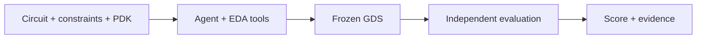

<h1 align="center">ICLayout-Bench</h1>

<p align="center">
  <strong>A benchmark framework for AI-driven integrated-circuit layout.</strong><br>
  <sub>From netlists to GDS, with isolated EDA tools and independent evaluation.</sub>
</p>

<p align="center">
  <a href="README_CN.md">简体中文</a> ·
  <a href="#quick-start">Quick Start</a> ·
  <a href="#documentation">Documentation</a> ·
  <a href="https://github.com/lizhangmai/ICLayout-Bench/issues">Issues</a>
</p>

<p align="center">
  <a href="https://github.com/lizhangmai/ICLayout-Bench/actions/workflows/checks.yml"></a>
  <a href="docs/running.md#experiment-environment"></a>
  <a href="LICENSE"></a>
</p>

## Why ICLayout-Bench?

Measure how well an Agent turns a circuit, constraints and process resources into
an integrated-circuit layout. Run experiments, compare agent configurations or
connect your controller to an HTTP evaluation service.

| Capability | What it provides |
| --- | --- |
| **End-to-end layout tasks** | Declared netlists, operating conditions, physical constraints and PDK resources, with GDS as the submission. |
| **Independent evaluation** | Artifact checks, DRC, LVS, parasitic extraction and post-layout measurements on frozen candidate bytes. |
| **Native agent harnesses** | Codex, Claude Code, DSH, Kimi Code and ZCode, plus custom controllers through HTTP/MCP. |
| **Repeatable experiments** | Explicit model/effort conditions, independent repetitions, saved evidence and interrupted-session recovery. |
| **Usage and cost analysis** | Native token counts, timing and cost coverage alongside the independent score. |

## Prerequisites

- **Python 3.12+**.
- **An installed, authenticated agent CLI** or your own controller.
- **A task Dataset**, such as the public [ICLayout-Bench Dataset](https://huggingface.co/datasets/lizhangmai/ICLayout-Bench), supplied by repository ID or directory.
- **For local evaluation:** Linux x86-64, Docker and a compatible EDA image.
  Remote participation uses the operator's tools instead.

<a id="install-and-run"></a>

## Quick Start

**1. Install Bench.**

```bash
python -m pip install iclayout-bench
```

For local wheel or source installation, see
[installation options](docs/running.md#experiment-environment).
To run EDA on your machine, pull the published tools image:

```bash
docker pull docker.io/lizhangmai/iclayout-bench-tools:latest
```

You can also [build or select another compatible image](docs/tools.md#prebuilt-images-and-local-builds).

**2. Write `experiment.toml`.** Replace the model ID and effort with your settings.
This example uses the public Dataset; `source` also accepts other Dataset IDs or
directories. Configuration and output paths are yours to choose.

```toml
harness = "codex"
model = "your-model-id"
effort = "medium"
concurrency = 1
repetitions = 1

[dataset]
source = "lizhangmai/ICLayout-Bench"
name = "core"
split = "test"
```

**3. Inspect one task, then run it.** Bench downloads the selected Dataset on
first use. This example selects `NAND2_X1` from its core tasks.

```bash
# Inspect configuration and task bindings without model or Docker calls.
python -m benchmarking.run \
  --config experiment.toml --case NAND2_X1 --dry-run

# Run the Agent and independently evaluate its submitted layout.
python -m benchmarking.run \
  --config experiment.toml --case NAND2_X1 \
  --image docker.io/lizhangmai/iclayout-bench-tools:latest
```

Results go to `results/experiment/<task-id>/<timestamp>/`, including the verdict,
model usage, retained logs and available GDS/preview assets. Omit `--case` to run
the configured selection, or add `--output /path/to/results` to select an output
root. See the [running guide](docs/running.md) for remote participation, multiple
conditions and recovery.

## How It Works



The Agent performs device implementation, placement, routing and iteration.
The evaluator checks the accepted layout snapshot in a separate trusted
environment. Scores range from **0 to 100**, measuring physical and electrical
quality against each task's declared targets. A feasible layout can still have
room to improve.

<a id="resources"></a>

## Documentation

| Need | Guide |
| --- | --- |
| Configure harnesses, run experiments, recover sessions and analyze results | [Running](docs/running.md) |
| Understand task inputs, scoring and reference qualification | [Tasks](docs/tasks.md) |
| Set up images, PDK resources and EDA backends | [Tools](docs/tools.md) |
| Understand ownership, isolation and the HTTP contract | [Architecture](docs/architecture.md) |
| Develop and verify framework changes | [Contributing](CONTRIBUTING.md) |

## FAQ

<details>
<summary><strong>Where are the tasks and reference layouts?</strong></summary>

Tasks live in an independently supplied Dataset, selected by explicit path or
repository revision. The Python package bundles no tasks. Delivered Datasets omit
reference layouts and qualification evidence; authors retain those separately.

</details>

<details>
<summary><strong>Do remote participants need Docker or a PDK?</strong></summary>

No. Use the operator's endpoint and scoped credentials; its service provides the
EDA workspace and evaluation tools. Local evaluation requires the compatible
image and declared process resources.

</details>

<details>
<summary><strong>Does passing a task mean a score of 100?</strong></summary>

Passing establishes physical and functional validity. Scores measure quality
against declared electrical and area targets, with each metric capped at its
target. A reference proves feasibility and can score below 100. See
[scoring](docs/tasks.md#task-scoring).

</details>

<details>
<summary><strong>Are token counts and costs always available?</strong></summary>

The framework retains native usage when the harness supplies it. Missing counts,
timing or prices remain unknown. Token-based costs use the frozen price table
and can differ from the actual bill. See [usage and cost](docs/running.md#model-usage-and-cost).

</details>

<details>
<summary><strong>How is execution provenance recorded?</strong></summary>

Participant-managed execution is recorded as `self_run`. Execution with frozen
conditions and operator-verified evidence uses `controlled_run`. These labels
describe execution provenance; importing or sharing a result preserves its
original evaluation mode.

</details>

## License

The framework is [MIT licensed](LICENSE). Task materials, PDKs and EDA tools retain
their own licenses; consult the selected Dataset's notices for material rights.

<p align="center">
  <a href="https://github.com/lizhangmai/ICLayout-Bench">Repository</a> ·
  <a href="https://github.com/lizhangmai/ICLayout-Bench/issues">Report an Issue</a> ·
  <a href="CONTRIBUTING.md">Contribute</a>
</p>
