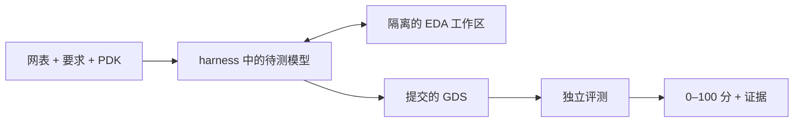

<h1 align="center">ICLayout-Bench</h1>

<p align="center">
  <strong>面向 AI 集成电路版图设计的评测框架。</strong><br>
  <sub>从网表到 GDS，通过隔离的 EDA 环境和独立评测衡量 Agent 的设计能力。</sub>
</p>

<p align="center">
  <a href="README.md">English</a> ·
  <a href="#快速开始">快速开始</a> ·
  <a href="https://huggingface.co/datasets/lizhangmai/ICLayout-Bench">题库</a> ·
  <a href="#文档">文档</a> ·
  <a href="https://github.com/lizhangmai/ICLayout-Bench/issues">问题反馈</a>
</p>

<p align="center">
  <a href="https://github.com/lizhangmai/ICLayout-Bench/actions/workflows/checks.yml"></a>
  <a href="docs/running.md#experiment-environment"></a>
  <a href="LICENSE"></a>
</p>

## 为什么使用 ICLayout-Bench？

ICLayout-Bench 衡量 LLM Agent 将晶体管级电路、工作条件和工艺设计套件（PDK）
转化为正确、高质量版图的能力。模型通过 Agent CLI（即 *harness*）参评：
Bench 为 Agent 提供题目和隔离的 EDA 工作区，冻结它提交的 GDS，再独立评分。



公开的 [ICLayout-Bench 题库](https://huggingface.co/datasets/lizhangmai/ICLayout-Bench)
包含基于 FreePDK45、GF180MCU、IHP SG13G2 和 SKY130A 四套开源 PDK 的 92 道题，
覆盖逻辑单元、SRAM、稳压器、数据转换器和射频放大器等电路。
其中 21 道 **core** 题构成标准评测集。

| 能力 | 提供什么 |
| --- | --- |
| **完整的版图任务** | 声明网表、工作条件、物理约束和 PDK 资源，以 GDS 作为提交产物。 |
| **独立评测** | 对冻结的候选版图执行产物检查、DRC、LVS、寄生提取和版图后测量。 |
| **原生 Agent 接入** | 支持 Codex、Claude Code、DSH、Kimi Code、ZCode，以及通过 HTTP/MCP 接入的自定义控制器。 |
| **可重复实验** | 显式配置模型与 effort，支持独立重复、证据保留和中断会话恢复。 |
| **用量与费用分析** | 在独立分数之外记录原生 token 用量、耗时、费用及统计覆盖情况。 |

## 选择使用方式

| 你想要 | 从这里开始 |
| --- | --- |
| 在自己的机器上评测模型或 Agent | [快速开始](#快速开始) |
| 评测自己的 Agent 程序，或添加 MCP 服务器等工具 | [自定义控制器与工具方案](docs/running.md#participant-tool-schemes) |
| 不调用模型，直接为已有 GDS 评分 | [独立评测](docs/running.md#standalone-evaluation) |

## 环境要求

你需要：

- **Linux x86-64**，当前账户可使用的 **Docker**，以及用于隔离 Agent CLI 的
  **Bubblewrap**（`bwrap`，通常由 `bubblewrap` 软件包提供）。
- **Python 3.12+** 和 **Git**。
- **一个受支持的 Agent CLI**，已安装、已登录，并能访问待测模型；见[第 2 步](#2-接入模型)。
- **可访问 Hugging Face**，以便首次运行时下载公开题库；也可使用本地题库目录。

## 快速开始

### 1. 安装 Bench 和 EDA 镜像

在新的 Python 3.12+ 虚拟环境中执行：

```bash
python -m pip install iclayout-bench
docker pull docker.io/lizhangmai/iclayout-bench-tools:latest
```

安装包只包含框架；题目来自题库，EDA 工具来自镜像。首次运行前检查主机环境：

```bash
python -m benchmarking.eda doctor                                 # Linux、Python、Git、Docker
bwrap --unshare-all --share-net --ro-bind / / true && echo "bwrap OK"
```

wheel 或源码安装见[安装选项](docs/running.md#experiment-environment)；
使用其他镜像见[镜像说明](docs/tools.md#prebuilt-images-and-local-builds)。

### 2. 接入模型

Bench 本身不调用模型 API，而是启动与模型通信的 Agent CLI，并在每条结果中记录
模型 ID 和 effort。选择能访问待测模型的 harness，然后用该 CLI 完成登录：

| 模型的访问方式 | `harness` | `model` 取值 | 准备工作 |
| --- | --- | --- | --- |
| OpenAI（ChatGPT 登录或 API key） | `codex` | Codex 接受的模型 ID | `codex login`；见 [Codex](docs/running.md#codex) |
| Anthropic（Claude 登录或 API key） | `claude-code` | Claude Code 接受的模型 ID | 登录 Claude Code；见 [Claude Code](docs/running.md#claude-code-and-dsh) |
| Kimi Code 账户 | `kimi-code` | Kimi 配置中的模型别名 | `kimi login`；见 [Kimi Code](docs/running.md#kimi-code) |
| BigModel 或 Z.AI 编程套餐 | `zcode` | `account:<套餐>/<模型>` | 在专用 profile 中 `zcode login`；见 [ZCode](docs/running.md#zcode) |
| 任意 OpenAI 或 Anthropic 兼容 API | `zcode` | `<provider>/<模型>` | 在 profile 的 `config.json` 中声明 endpoint 和密钥变量；见 [ZCode](docs/running.md#zcode) |
| DSH | `dsh` | DSH 接受的模型 ID | 在其 home 中配置 `settings.yaml`；见 [DSH](docs/running.md#claude-code-and-dsh) |
| 自己的 Agent 程序 | `command` | 随结果记录的标签 | 声明 `[scheme.launch]`；见[自定义控制器](docs/running.md#participant-tool-schemes) |

原生 harness 默认使用 CLI 的常规登录状态。若要隔离评测凭据，可在专用 profile
目录中登录，并用 `harness_home` 指向该目录（[详细说明](docs/running.md#native-harness-configuration)）。
每次运行都在沙箱中进行：Agent 只能看到题目和 Bench 提供的工具，看不到你个人的
skills、规则、记忆、插件或 MCP 服务器；配置中的模型和 effort 会覆盖 CLI 自身设置。

### 3. 编写 `experiment.toml`

```toml
harness = "codex"            # 第 2 步选择的 harness
model = "your-model-id"      # 该 harness 使用的准确模型 ID
effort = "medium"            # 模型支持的推理 effort
concurrency = 1              # 同时求解的题目数
repetitions = 1              # 每道题的独立求解次数
# harness_home = "profiles/codex"   # 可选：专用登录 profile

[dataset]
source = "lizhangmai/ICLayout-Bench"  # 题库仓库 ID 或本地目录
name = "core"                         # "core" 标准评测集或 "all" 全部题目
split = "test"
```

文件中的路径相对于该文件所在目录解析。完整字段见[配置参考](docs/running.md#configuration-reference)。

### 4. 检查配置，再求解一道题

```bash
# 解析配置与题目绑定，不调用模型或 Docker。
python -m benchmarking.run --config experiment.toml --case NAND2_X1 --dry-run

# 求解并评测一道小题。这一步会真实调用模型。
python -m benchmarking.run --config experiment.toml --case NAND2_X1
```

首次运行时会下载题库。`NAND2_X1` 是一个两输入逻辑门，适合快速走通完整流程。
Agent 会一直工作到提交或求解预算耗尽；每道题声明各自的预算，从一小时到数小时不等。
dry-run 不检查登录、额度或 Docker，这些在第一次真实运行时才会暴露。

### 5. 查看结果

结果按配置文件名归入 `results/<配置文件名>/`：

```bash
python -m benchmarking.run --status --output results/experiment
```

输出列出每次运行的 `state`、独立评测结论 `outcome`（`pass` 或 `fail`）和
`score`（0–100）。每个运行目录 `results/experiment/<task-id>/<timestamp>/` 保留证据：

| 文件 | 内容 |
| --- | --- |
| `result.json` | 分数与指标、评测结论、实验条件、token 用量和已知费用 |
| `final.gds`、`layout.png` | 计分版图及预览图 |
| `evaluation/` | 评测计划、测量结果及 DRC/LVS/寄生提取/仿真日志 |
| `agent.jsonl`、`native/` | Agent 启动记录和原生会话日志 |

各字段含义见[读取运行结果](docs/running.md#read-a-run)。

### 6. 运行 core 评测集

省略 `--case` 即运行配置中的全部选题。长时间批量运行时，指定输出目录并在后台执行：

```bash
python -m benchmarking.run --config experiment.toml --output results/my-model --detach
python -m benchmarking.run --status --output results/my-model   # 进度和分数
python -m benchmarking.run --stop --output results/my-model     # 停止并保留证据
python -m benchmarking.run --config experiment.toml --output results/my-model --resume --detach
```

最后一条命令用于继续中断的批次：已完成的题目会被跳过，未完成的会话保留原截止时间。
`concurrency = 1` 时 core 题目依次运行，每题最多用满各自的求解预算，完整跑一遍可能超过一天。
可在机器资源和模型服务限流允许的范围内提高 `concurrency`。
其他恢复操作见[失败恢复](docs/running.md#failure-recovery)。

## 下一步

- **比较模型或 effort：** 使用 `efforts = ["medium", "high"]`、多个 `--config`
  文件或 matrix；用 `repetitions` 设置独立重复次数。
  见[多条件实验](docs/running.md#multiple-conditions-and-repetitions)。
- **统计用量与费用：** 添加 `[pricing]` 表，然后用
  `python -m benchmarking.analyze results/my-model/*/*/result.json --output results/my-model-analysis`
  导出每次运行的 token、费用和耗时。见[用量与费用](docs/running.md#model-usage-and-cost)。
- **添加参评工具：** 在 `[scheme]` 中声明 MCP 服务器、说明或求解镜像。
  见[参评工具方案](docs/running.md#participant-tool-schemes)。

## 评分方式

Agent 在 EDA 工作区中完成器件实现、布局、布线和迭代，提交前可运行过程检查。
评测器随后在独立的可信环境中检查已接受的版图快照，包括产物检查、DRC、LVS、
寄生提取和版图后测量。被拒绝的版图记 0 分，求解预算耗尽或 Agent 出错的运行同样记 0 分；
基础设施错误导致的分数保持未知，而不是记为 0。有效版图依据每题声明的电气与面积目标
衡量质量，最高 **100** 分。获得可行解后，仍然可以继续提高质量。
具体规则见[评分说明](docs/tasks.md#task-scoring)。

## 文档

| 需要什么 | 阅读位置 |
| --- | --- |
| 配置 harness、运行实验、恢复会话和分析结果 | [运行指南](docs/running.md) |
| 理解任务输入、评分和参考解验证 | [任务契约](docs/tasks.md) |
| 准备镜像、PDK 资源和 EDA 后端 | [工具环境](docs/tools.md) |
| 理解职责、隔离边界和 HTTP 契约 | [架构](docs/architecture.md) |
| 开发和验证框架改动 | [贡献指南](CONTRIBUTING.md) |

## 常见问题

<details>
<summary><strong>Agent 启动前运行就失败了，应该检查什么？</strong></summary>

运行 `python -m benchmarking.eda doctor` 和[第 1 步](#1-安装-bench-和-eda-镜像)中的 `bwrap` 检查。
缺少 Bubblewrap 隔离时，Bench 会拒绝启动 Agent。登录、endpoint 和额度问题只在真实运行时出现，
请检查对应的 harness profile。见[启动故障排查](docs/tools.md#startup-troubleshooting)。

</details>

<details>
<summary><strong>题目和参考解在哪里？</strong></summary>

题目由独立 Dataset 提供，通过显式路径或仓库版本选择，Python 包不携带题库。
公开和私有交付都不包含参考解及 qualification 证据，这些材料保留在作者侧。

</details>

<details>
<summary><strong>Agent 能使用我自己的 skills、MCP 服务器或配置吗？</strong></summary>

不会隐式使用。为保证实验条件可比，运行与个人 CLI 配置相互隔离。
额外的说明、MCP 服务器或文件需在[参评工具方案](docs/running.md#participant-tool-schemes)中声明，
方案会随结果一同记录。

</details>

<details>
<summary><strong>通过任务就意味着得 100 分吗？</strong></summary>

通过代表满足物理与功能要求。评分依据声明的电气和面积目标衡量质量，
每项指标在目标处封顶。参考解用于证明可行性，也可能低于 100 分。
具体规则见[评分说明](docs/tasks.md#task-scoring)。

</details>

<details>
<summary><strong>token 和费用统计一定完整吗？</strong></summary>

框架保留 harness 提供的原生用量。缺失的 token、耗时或单价保持未知；
按 token 计价时使用冻结的价目表，计算结果可能与实际账单不同。
具体语义见[用量与费用](docs/running.md#model-usage-and-cost)。

</details>

## 许可证

框架采用 [MIT 许可证](LICENSE)。任务材料、PDK 和 EDA 工具保留各自的许可证；
材料使用权以所选 Dataset 的许可与声明为准。

<p align="center">
  <a href="https://github.com/lizhangmai/ICLayout-Bench">项目仓库</a> ·
  <a href="https://github.com/lizhangmai/ICLayout-Bench/issues">提交问题</a> ·
  <a href="CONTRIBUTING.md">参与贡献</a>
</p>
