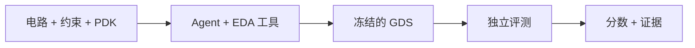

<h1 align="center">ICLayout-Bench</h1>

<p align="center">
  <strong>面向 AI 集成电路版图设计的评测框架。</strong><br>
  <sub>从网表到 GDS，通过隔离的 EDA 环境和独立评测衡量 Agent 的设计能力。</sub>
</p>

<p align="center">
  <a href="README.md">English</a> ·
  <a href="#快速开始">快速开始</a> ·
  <a href="#文档">文档</a> ·
  <a href="https://github.com/lizhangmai/ICLayout-Bench/issues">问题反馈</a>
</p>

<p align="center">
  <a href="https://github.com/lizhangmai/ICLayout-Bench/actions/workflows/checks.yml"></a>
  <a href="docs/running.md#experiment-environment"></a>
  <a href="LICENSE"></a>
</p>

## 为什么使用 ICLayout-Bench？

衡量 Agent 将电路、约束和工艺资源转化为集成电路版图的能力。
你可以运行实验、比较不同模型与工具配置，或通过 HTTP 评测服务接入自己的控制器。

| 能力 | 提供什么 |
| --- | --- |
| **完整的版图任务** | 声明网表、工作条件、物理约束和 PDK 资源，以 GDS 作为提交产物。 |
| **独立评测** | 对冻结的候选版图执行产物检查、DRC、LVS、寄生提取和版图后测量。 |
| **原生 Agent 接入** | 支持 Codex、Claude Code、DSH、Kimi Code、ZCode，以及通过 HTTP/MCP 接入的自定义控制器。 |
| **可重复实验** | 显式配置模型与 effort，支持独立重复、证据保留和中断会话恢复。 |
| **用量与费用分析** | 在独立分数之外记录原生 token 用量、耗时、费用及统计覆盖情况。 |

## 环境要求

- **Python 3.12+**。
- **已安装并完成认证的 Agent CLI**，或自己的控制器。
- **任务 Dataset**，例如公开的 [ICLayout-Bench 题库](https://huggingface.co/datasets/MAI716/ICLayout-Bench)，通过仓库 ID 或目录指定。
- **本地评测额外需要：** Linux x86-64、Docker 和兼容的 EDA 镜像。
  远程参评使用运营方提供的工具环境。

## 快速开始

**1. 安装 Bench。**

```bash
python -m pip install iclayout-bench
```

本地 wheel 和源码安装方式见[安装选项](docs/running.md#experiment-environment)。
在自己的机器上运行 EDA 时，拉取公开工具镜像：

```bash
docker pull docker.io/lizhangmai/iclayout-bench-tools:latest
```

也可[构建或选择其他兼容镜像](docs/tools.md#prebuilt-images-and-local-builds)。

**2. 编写 `experiment.toml`。** 替换为自己的模型 ID 和 effort。
示例使用公开题库；`source` 也接受其他 Dataset ID 或目录。
配置文件和输出目录的位置可自行选择。

```toml
harness = "codex"
model = "your-model-id"
effort = "medium"
concurrency = 1
repetitions = 1

[dataset]
source = "MAI716/ICLayout-Bench"
name = "core"
split = "test"
```

**3. 检查单题配置，再启动实验。** 首次使用时会下载所选题库。
下面以核心选题中的 `NAND2_X1` 为例。

```bash
# 检查配置与题库绑定，不调用模型或 Docker。
python -m benchmarking.run \
  --config experiment.toml --case NAND2_X1 --dry-run

# 启动 Agent，并独立评测它提交的版图。
python -m benchmarking.run \
  --config experiment.toml --case NAND2_X1 \
  --image docker.io/lizhangmai/iclayout-bench-tools:latest
```

结果保存在 `results/experiment/<task-id>/<timestamp>/`，包括评测结论、模型用量、
保留的日志及可用的 GDS／预览图。省略 `--case` 可执行配置中的全部选题。
也可用 `--output /path/to/results` 指定输出根目录。
远程参评、多条件实验和恢复方式见[运行指南](docs/running.md)。

## 工作方式



Agent 完成器件实现、布局、布线和迭代；评测器在独立的可信环境中检查已接受的版图快照。
分数范围为 **0–100**，依据每题声明的目标衡量物理与电气质量。
获得可行解后，仍然可以继续提高质量。

## 文档

| 需要什么 | 阅读位置 |
| --- | --- |
| 配置 harness、运行实验、恢复会话和分析结果 | [运行指南](docs/running.md) |
| 理解任务输入、评分和参考解验证 | [任务契约](docs/tasks.md) |
| 准备镜像、PDK 资源和 EDA 后端 | [工具环境](docs/tools.md) |
| 理解职责、隔离边界和 HTTP 契约 | [架构](docs/architecture.md) |
| 开发和验证框架改动 | [贡献指南](CONTRIBUTING.md) |

## 常见问题

<details>
<summary><strong>题目和参考解在哪里？</strong></summary>

题目由独立 Dataset 提供，通过显式路径或仓库版本选择，Python 包不携带题库。
公开和私有交付都不包含参考解及 qualification 证据，这些材料保留在作者侧。

</details>

<details>
<summary><strong>远程参评也需要 Docker 和 PDK 吗？</strong></summary>

不需要。使用运营方提供的 endpoint 和作用域凭据，由服务提供 EDA 工作区与评测工具。
本地评测才需要兼容镜像和声明的工艺资源。

</details>

<details>
<summary><strong>通过任务就意味着得 100 分吗？</strong></summary>

通过代表满足物理与功能要求。评分依据声明的电气和面积目标衡量质量，
每项指标在目标处封顶。参考解用于证明可行性，也可能低于 100 分。
具体规则见[评分说明](docs/tasks.md#task-scoring)。

</details>

<details>
<summary><strong>token 和费用统计一定完整吗？</strong></summary>

框架保留 harness 提供的原生用量。缺失的 token、耗时或单价保持未知；
按 token 计价时使用冻结的价目表，计算结果可能与实际账单不同。
具体语义见[用量与费用](docs/running.md#model-usage-and-cost)。

</details>

<details>
<summary><strong>结果如何记录执行来源？</strong></summary>

参评者自行管理的执行记录为 `self_run`；冻结条件并由运营方核验完整证据的执行
记录为 `controlled_run`。这些标签描述执行来源，导入或分享结果保留原有评测模式。

</details>

## 许可证

框架采用 [MIT 许可证](LICENSE)。任务材料、PDK 和 EDA 工具保留各自的许可证；
材料使用权以所选 Dataset 的许可与声明为准。

<p align="center">
  <a href="https://github.com/lizhangmai/ICLayout-Bench">项目仓库</a> ·
  <a href="https://github.com/lizhangmai/ICLayout-Bench/issues">提交问题</a> ·
  <a href="CONTRIBUTING.md">参与贡献</a>
</p>
