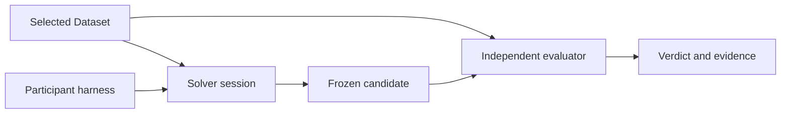

# Architecture and HTTP Contract

ICLayout-Bench loads an explicitly selected task Dataset, runs isolated solver
sessions and independently evaluates frozen candidate layouts. The installed
package provides commands, Python APIs, task contracts and an
[HTTP protocol](#http-session). Use this reference to integrate a controller,
host an evaluation service or understand how submissions are evaluated.



## Terms

| Term | Meaning |
| --- | --- |
| Dataset | Independently supplied task contracts, materials and resource declarations, selected by path or repository revision. |
| Case / task | A circuit layout problem. A case wraps the executable task and its metadata; its stable ID comes from the contract. |
| Condition | One resolved harness, model, effort and declared participant-tool configuration. |
| Repetition | An independent scheduled solve for a task under one condition. |
| Attempt | A solve with its own workspace and budget. Explicit replacement creates a new attempt and retains the earlier evidence. |
| Session | The service workspace, scoped credential, accepted candidates and deadline used by an attempt. |
| Continuation | Another native launch using the same session, conversation and deadline. |
| Collection | Settlement and export of an existing session without a model launch. |
| Candidate | A participant-produced layout; an accepted submission is an immutable snapshot. |
| Source | The authoritative circuit and fixed pre-layout measurements used by evaluation. |
| Reference / witness | An author-retained feasible layout used for qualification, excluded from task deliveries and solver inputs. |

## System roles and boundaries

| Role | Owns | Supplies to the next stage |
| --- | --- | --- |
| Task author | Complete circuit, requirements, resource declarations and feasibility evidence. | Static task contracts and reviewed solver inputs; references remain with the author. |
| Participant | Harness, model configuration, tool choices and complete experiment results. | Immutable candidate submissions and participant-reported traces/usage. |
| Evaluator | Trusted inputs, isolated checks, extraction, measurements and scoring. | Independent verdicts and evidence bound to the submitted bytes. |
| Operator | Task admission, deployment, credentials, capacity and disclosure. | Explicit service access and reviewed result releases. |

Authors define the problem; the Agent performs circuit import, device
implementation, placement, routing and iteration using declared EDA resources.
Generic adapters handle tool invocation and report parsing while preserving the
circuit and process semantics. They do not construct or repair the participant's
design. [Tasks](tasks.md) defines accepted inputs, validity gates and scoring.

Evaluator adapters may bind files, parse native reports and reorder an existing
named interface. They must preserve extracted device models, terminals,
multiplicity, physical parameters and parasitics. They do not repair disconnected
contacts, infer missing geometry from the expected circuit, replace extracted
devices with source devices, or discard parameters to make simulation succeed.
The declared process resources must provide compatible extraction and simulator
interfaces. Reference qualification establishes feasibility for those resources;
changing them requires validation of the affected flow.

A solver receives declared task materials and reviewed resources. Reference
layouts, author working libraries, qualification evidence, unrelated cases and
model/website/session credentials remain outside EDA containers. An explicit
[commercial runtime](tools.md#external-commercial-runtimes) can supply reviewed tool license access.
Commercial Agents solve inside the declared container. Trusted commercial
evaluation runs on the operator host in fresh job directories, using declared
EDA modules, PDKs and license settings. Commercial evaluation does not inspect
or launch Docker images and does not fall back between execution locations.
The evaluator uses immutable candidate snapshots separately from writable solver
state. Derived tool-specific circuit representations retain the authoritative
circuit semantics; their run hashes record evidence integrity rather than task
freshness. Authors verify that semantic agreement.

## Execution entry points

Run these modules with `python -m` in the environment where Bench is installed.

| Entry point | Purpose |
| --- | --- |
| `benchmarking.run` | Schedule participant experiments, supervise harnesses and export terminal results. |
| `benchmarking.service` | Provide the local HTTP session adapter and independent evaluation. |
| `benchmarking.evaluation` | Inspect tasks, characterize circuits or evaluate an explicit GDS. |
| `benchmarking.evaluation qualify` | Audit and verify an author-retained feasible reference. |
| `benchmarking.execution` | Check controlled inference access or recover frozen workspace submissions. |
| `benchmarking.eda` | Inspect declared resources and prepare or build an EDA environment. |
| `benchmarking.client` | Use an existing service through the generic HTTP client. |
| `benchmarking.analyze`, `benchmarking.results` | Export structured statistics and optionally retain an archive. |

[Running](running.md) provides end-to-end commands; [Harnesses](running.md#harness-configuration)
configures native or custom decision loops. Installing a layout library in a
solver image does not itself require a new harness. The framework supplies the
workspace and tools while each participant controls its next action.

The bundled server binds to loopback and supports one case and one active
session. Operators provide production authentication, TLS, capacity and task
admission. Native model credentials stay with the participant host or its
controlled gateway. [Tools](tools.md) defines resource/image preparation.

## Evaluation identity and process checks

An experiment records participant instructions, model/effort, tools and optional
solver image independently from trusted task/evaluator resources. Comparable
conditions require matching task context, evaluator identity and limits.
[Results](running.md#comparisons) defines archive comparisons.

`process-feedback` uses the trusted evaluation path to check the current candidate
without submitting it. It consumes solve time and exposes measurements and
functional diagnostics, while final scores belong to terminal evaluation.
[Protocol](#process-feedback) defines that interface. Source
characterization is frozen during task design; candidate judging runs the
post-layout plan rather than generating new author baselines.

## Result handoff and storage ownership

Bench exports terminal results, structured statistics and EDA preview assets.
You can retain them in a local archive or pass them to an application for charts,
interactive comparisons and publication. Keep the experiment configuration and
original evidence available when interpreting or sharing a result.

Submission, local archive import, transfer and public disclosure are separate
operations. [Results](running.md#website-result-delivery) describes portable
packages and optional upload. Receipt or a durable import job ID confirms
transfer, not publication. A shared read-only filesystem is an explicit data
handoff; it is not a source-code dependency. Participants do not need website
database credentials.

The optional archive accepts terminal participant and service results through
`ResultStore`. Its `object_store` supplies `put(bytes) -> (sha256, size)` and
`path(sha256) -> Path`; the default uses local content-addressed files. Archive
validation preserves candidate, task and condition identity independently of the
storage backend. [Results](running.md#result-archive) owns archive commands,
attachments, backup and migration.

## Verified reruns and disclosure

`self_run` denotes participant-controlled execution. `controlled_run` requires an
operator to freeze conditions, control execution and check complete evidence.
These labels are independent of score, model identity, import and publication.
A declared model ID records the requested condition without attesting the
provider's internal implementation.

Controlled verification binds task inputs, resources, budgets, repetition
schedule, participant conditions, candidate bytes and independent verdicts.
Missing/modified evidence prevents verification. Operators review restricted
material exposure and aggregate disclosure. Reference qualification establishes
feasibility under its declared conditions; it does not certify participant
performance or authorize publication.

<a id="http-session"></a>

## HTTP session contract

`layout-http` connects participants to isolated workspaces and independent
evaluation. The bundled service and its generic client use the format below.

### Authentication and common format

All routes are relative to the service URL and use `Authorization: Bearer TOKEN`.
An operator creation token authorizes `POST /sessions`; its response returns a
new token scoped to that session. Use HTTPS except on loopback development hosts.
Wrong or nonexistent session/token pairs return `404` after bearer validation.
Queries remain available until the creation response's `retained_until`.

JSON uses UTF-8, finite numbers, UTC RFC 3339 timestamps and lowercase SHA-256
hex digests. Responses include `protocol: "layout-http"`; requests omit this
response metadata. Clients ignore unknown response fields and reject unknown
protocol identifiers. The service rejects unknown request fields or wrong types.

Every POST requires `Idempotency-Key`: 1–128 ASCII letters, digits, `_`, `-` or
`.`. Repeating the same route/key/body returns the stored response; changing the
body under that key returns `409 conflict`. A lost reply has unknown outcome:
replay the identical mutation or inspect its receipt before issuing another.
A submission replay returns its original snapshot rather than rereading output.

### Create a session

Start a local service with one explicit case, an installed compatible image and
the creation credential already set in `ICLAYOUT_BENCH_TOKEN`:

```bash
python -m benchmarking.service \
  --dataset /path/to/dataset --case freepdk45.nangate45-pdk.NAND2_X1 \
  --data results/local-service \
  --token-env ICLAYOUT_BENCH_TOKEN
```

Run client commands in another terminal with the same installed environment:

```bash
export ICLAYOUT_BENCH_ENDPOINT=http://127.0.0.1:8765
python -m benchmarking.client --key create-1 POST sessions <<'JSON'
{"task_id":"freepdk45.nangate45-pdk.NAND2_X1","condition":{"harness_kind":"agent","harness_id":"local-cli","harness_version":"1","model":"YOUR_MODEL","prompt_sha256":null,"configuration_sha256":null}}
JSON
```

Creation returns HTTP 201 with `session_id`, `session_token`, status fields,
`task`, `capabilities`, `limits`, `tool_identity` and `retained_until`. Set
`ICLAYOUT_BENCH_SESSION` to that ID and replace `ICLAYOUT_BENCH_TOKEN` with its
scoped token before further commands. `condition` has exactly the fields in the
example: harness kind is `agent`, text IDs are nonempty and the two SHA-256
fields may be null when unknown. Condition metadata is participant-reported.

Provisioning has a separate 600-second startup window, with a 30-second HTTP
response allowance. It covers durable resource archival and container startup;
solve time begins at the existing container-launch boundary. An interrupted
creation key returns a nonretryable infrastructure failure on replay and never
provisions a second session. Successful creation replays its original response.

### Lifecycle and budgets

Status progresses from `active` to `evaluating`, then `complete` or `error`.
Closing freezes selection and starts independent evaluation. Status includes
`created_at`, `deadline`, `remaining_seconds`, `active_execution_id`,
`last_submission`, `capabilities`, check `diagnostics` and `budget`.

The authoritative budget is `[task].hours`; `limits.wall_seconds` is that value
in seconds. The service cannot replace it with a participant-selected budget.
The frozen `limits.phase_budgets` declares `solve_seconds`, `command_seconds`,
`settlement_seconds` and `evaluation_seconds`. These are independent finite
allowances, rather than a session-wide soft/hard switch.

| `phase` | Transition and permitted work |
| --- | --- |
| `solving` | Until the original solve deadline; commands/checks/writes may start. |
| `draining` | An operation started before solve expiry finishes within its original command deadline; no new commands/checks/writes. |
| `settling` | Final read/submission/close until the later of solve expiry and the last bounded operation end, plus the settlement allowance. |
| `expired` | Submission window exhausted; close selection and remove the workspace. |
| `evaluating` | Workspace closed; the frozen accepted candidate is independently judged under the final-evaluation allowance. |
| `complete`, `error` | Terminal result; an infrastructure failure preserves candidate and diagnostic evidence. |

Status keeps the coarse `state` for protocol compatibility and exposes `phase`
separately. `budget` includes phase-specific remaining times. Command defaults are
3600 seconds, settlement 60 seconds; the final-evaluation allowance is the sum of
job tool timeouts (300 seconds for a backend without a declared tool timeout),
plus 60 seconds. Execution requests with null timeout use the command cap;
positive timeouts are clamped to that cap. Cancellation and polling remain available
after solve expiry. Native evaluator timeouts are always enabled in sessions.
Final evaluation records an absolute deadline at phase entry. Observation and
recovery consume that deadline rather than creating another allowance.

Standalone solver configurations may declare `[phase_budgets]` with
`command_seconds`, `settlement_seconds` and `evaluation_seconds`; solve duration
still comes from the task. Without this table the command allowance equals the solve duration and
the settlement allowance is zero. The former `soft_budget` configuration is rejected. Elapsed time and
late submissions remain recorded; final judging grants no additional solve time.

CPU, memory and PID limits default to null, meaning no framework quota. The
local service enforces workspace/file/candidate/log/response bounds and publishes
`max_command_seconds`, matching the independent command cap.
[Tools](tools.md#eda-backend-contract) defines evaluator job time limits.

Workspace execution, file access and submission are serialized. A busy workspace
returns `409 conflict`; status, poll and cancel remain usable. New mutations
after closure return `410`, while previously acknowledged identical mutations
replay their original response. [Recovery](running.md#failure-recovery) defines durable workspace
checkpoints and native continuation without command replay.

### Operations

Identifiers below are opaque. POST bodies have exactly the stated fields.
Creation returns 201, execution/close return 202 and other successes return 200.
All responses include the common `protocol` field.

| Method and route | Request | Response fields |
| --- | --- | --- |
| `POST /sessions` | `task_id`, `condition` | Creation fields described above. |
| `GET /sessions/{sid}` | None | Session status. |
| `GET /sessions/{sid}/file?path=...` | Relative workspace path | `path`, `content_base64`, `sha256`, `size_bytes`. |
| `POST /sessions/{sid}/files` | `path`, `content_base64` | `path`, `sha256`, `size_bytes`. |
| `POST /sessions/{sid}/executions` | `command`, `timeout_seconds` | `execution_id`, `state`. |
| `GET /sessions/{sid}/executions/{eid}?offset=N` | Nonnegative byte offset | `execution_id`, `state`, `exit_code`, `log_base64`, `next_offset`, `truncated`. |
| `POST /sessions/{sid}/executions/{eid}/cancel` | `{}` | `execution_id`, `state`. |
| `POST /sessions/{sid}/submissions` | `path` | Immutable candidate receipt. |
| `GET /sessions/{sid}/submissions/{id}` | None | Candidate receipt. |
| `GET /sessions/{sid}/requests/{operation}/{key}` | `operation` is `files`, `executions` or `submissions` | `known`, original `response` or null. |
| `POST /sessions/{sid}/close` | `{}` | `session_id`, `state`, `last_submission`. |
| `GET /sessions/{sid}/result` | None | Independent result described below. |
| `GET /sessions/{sid}/reports/{id}?offset=N` | Nonnegative character offset | `content`, `next_offset`, `has_more`. |
| `GET /sessions/{sid}/observations?offset=N` | Nonnegative event offset | `session_id`, `provenance`, `available`, `events`, `next_offset`, `has_more`. |

Executions use `running`, `complete`, `cancelled`, `timed_out` or `error`.
A nonzero shell exit can still be a completed execution; it is not the task
verdict. Decode base64 before joining bounded log slices. Poll until terminal and
drained; `truncated` means data beyond the retained log limit was discarded.

The local service advertises `process-feedback`. It does not implement optional
snapshot `diagnostics` or `opinions`; absent optional operations return `404` and
have zero allowance. A remote service may advertise its own implemented optional
capabilities. Process feedback uses ordinary execution/report routes, rather
than a separate diagnostics POST.

### Workspace, task and submissions

Creation supplies `task.id`, `sha256`, `problem`, `description`, `input_paths` and
`workspace_root: "/workspace"`. `problem` is the original declared UTF-8 problem
text and is the initial native prompt. `description` is the compact solver
manifest also staged at `/protocol/task.json`: declared inputs, netlist interface,
output, constraints, hours and reviewed resource metadata. It excludes full
internal evaluation plans, baselines, reference files and private metadata.

Declared inputs mount read-only under `/task`; reviewed resources under
`/resources`. File APIs operate only beneath `/workspace`, using normalized POSIX
relative paths. Traversal, symlinks and special files are rejected. Commands run
with `/bin/sh -lc` in `/workspace`; files persist across commands, shell exports
and leftover processes do not. The default runtime is offline and unprivileged;
[commercial runtimes](tools.md#external-commercial-runtimes) explicitly declare tool-license/network access.

Submission must use the task's exact workspace-relative output path. For example,
`/workspace/output/final.gds` is submitted as `output/final.gds`. A wrong path
returns `invalid_submission_path` and the expected path. Acceptance freezes a
bounded regular GDS and records `submission_id`, increasing `sequence`,
`candidate_sha256`, `size_bytes` and `accepted_at`. The last accepted candidate
wins; rejected submissions leave earlier accepted snapshots intact. Acceptance
confirms delivery, not validity. Final judging reads those immutable bytes in a
separate trusted environment.

With a session selected, the generic client can write and run your own generator:

```bash
python -m benchmarking.client status
python -m benchmarking.client write --key source-1 generate.py < generate.py
python -m benchmarking.client exec --key generate-1 'python /workspace/generate.py'
python -m benchmarking.client check --key check-1
python -m benchmarking.client submit --key candidate-1 output/final.gds
python -m benchmarking.client close --key finish-1
python -m benchmarking.client result --export results/custom-result
```

Create the generator first and use the actual declared output path. Model/harness
credentials remain with your controller; EDA commands run in the service workspace.

### Process feedback

`check` evaluates the current GDS through the final trusted plan without
submitting it. It consumes solve time, has no request-count cap and returns
physical/electrical diagnostics without score, weights or normalized quality
factors. It does not expose trusted source-paired scoring breakdowns.

MCP `execute` and `check` return after `wait_seconds` (default 10, range 0–30).
A `running` reply retains `execution_id` and `next_offset`; use `poll`, or `cancel`
to stop it. Response waits are independent from execution timeouts. Cancellation
propagates to evaluator jobs and retains failure evidence. New workspace
operations require the active execution to stop.

A completed feedback response includes the candidate binding, evaluator identity,
physical/electrical outcomes, metric values/units and bounded job diagnostics.
A successful command exit means the check was accepted: inspect
`feedback.outcome` for the verdict. Read the full `report_id` using MCP `report`
or `Client.report`, concatenating `content` until `has_more` is false. Report
offsets count characters; execution offsets count bytes. Reports remain readable
after closure under the same session token. Submit the chosen candidate explicitly
and expect independent final judging.

### Results and observation

A service result contains session/task/condition/tool identity, `limits`,
`evaluation_mode`, `provenance`, nullable `usage`, `submission`, `outcome`,
`task_success`, `score`, `metrics`, failure details and evidence. Before terminal
state, verdicts remain null. Terminal outcomes are `pass`, `fail`, `no_submission`
or `error`; [Tasks](tasks.md#evaluation) defines their scoring consequences.

`evaluation_mode` is `self_run` or `controlled_run`, independent of score and
publication. Provenance separates `server_observed`, `participant_reported` and
`unknown`. The service's nullable token/cost fields remain unknown when native
model calls are outside its observation. Participant exports separately retain
[model usage](running.md#model-usage-and-cost).

The read-only observations stream returns successful API-visible interactions,
ordered by sequence with timestamp, kind and data. It excludes denied requests,
participant-local activity and hidden evaluator material. Pages contain up to
100 events and approximately 256 KiB. Older services can report `available: false`.

```bash
python -m benchmarking.observe --output results/new-observation
```

This snapshots service events and result; optional `--participant-file FILE`
attaches a local trace with participant-reported provenance. Active snapshots are
partial. It makes no model calls or uploads. [Results](running.md#results-and-analysis) explains
analysis and retention.

### Errors and retries

Errors use this envelope:

```json
{"protocol":"layout-http","error":{"code":"invalid_request","message":"...","retryable":false}}
```

| HTTP status | Typical local meaning |
| --- | --- |
| 400 | Invalid JSON/fields, path or submission path. |
| 401 | Missing/invalid creation credential. |
| 404 | Unknown route, unavailable capability or session/token pair. |
| 409 | Conflicting mutation, busy workspace or `budget_exhausted`. |
| 410 | Closed session or expired retention. |
| 413 | Oversized request. |
| 503 | Capacity/unavailable response; retry only when explicitly retryable. |
| 500 | Infrastructure failure; retain diagnostics rather than inferring a verdict. |

Operator services may additionally enforce admission/rate-limit responses.
Only transport loss and explicitly retryable responses authorize configured HTTP
retry. The runner supplies its [retry policy](running.md#recovery-settings);
mutations retain identical keys and bodies. Infrastructure, harness and candidate
failures remain separate facts in the exported result.

## Shared execution and evidence interfaces

Applications embedding Bench can use the Python interfaces below with explicit
configuration, run directories and resource paths.

`benchmarking.participants.command.run_command` supervises a caller-selected
argv, working directory and declared condition through the public service. Its
configuration mapping contains `command`, `cwd` and `condition`; additional frozen
file bindings are retained as evidence, not interpreted by the runner. The caller
owns configuration freezing and experiment scheduling. Command and native runners
share budget interpretation, session settlement and terminal result waiting.
Arbitrary commands are not automatically restarted after interruption.

`benchmarking.results.verification.verify_frozen_run` checks one run against
explicit frozen task, agent, execution and implementation bindings. The caller
supplies the run directory and frozen asset root; the verifier owns archive paths,
event interpretation and evaluation input checks. `verify_service_result` checks
an HTTP result against the retained service store and frozen task/tool bindings.
Neither interface schedules batches or authorizes publication.
`benchmarking.results.scoring.verified_run_score` recomputes verified evidence and
applies the same attempt termination rules as execution.

`benchmarking.participants.attempt.attachments.attach_session_evidence` attaches the exact
scored candidate, independent evaluation and optional EDA preview to a terminal
participant export using an explicit service-store path. It does not call a model.
An explicit `renderer_runtime` selects native commercial EDA rendering; an
independent `renderer_image` selects image rendering. Renderer identity and
optional preview failures remain separate from the scored evaluation.
`benchmarking.participants.attempt.progress.inspect_run` provides a read-only projection of
runner, evaluation, attachment and preview phases. Attachment presence is not
archive verification. Optional usage collection from unfinished native traces is
marked partial; it does not create a terminal result or infer missing API timing.
Exports provide structured results for consumers to render. Recorded scores,
identities and archived attachments remain immutable.

`benchmarking.results.statistics` owns shared arithmetic. `wilson` supplies a
95% binomial score interval; `usage_summary` and `inference_summary` preserve
unknown resource usage. `planned_score_summary(values, scheduled)` distinguishes
missing observations from observed unknown scores and returns a complete-sample
mean only when every planned score is known. `weighted_score` combines explicit
task coefficient/score pairs, keeping the suite score unknown if any task score
is unknown. Callers own sample selection, cohort membership and frozen suite
bindings; these functions do not read operator batch plans or authorize releases.

`benchmarking.service.launch.launch_service` starts the installed local service
from explicit CLI arguments, an output directory and a process environment. It
owns readiness detection and bounded process-group shutdown, including failed
startup. Credentials stay in the supplied environment. A caller may explicitly
retain a ready service for recovery; that caller owns its durable process
identity and subsequent shutdown. Participant launchers and operator deployments
use the same mechanism with their respective runtime and retention settings.
